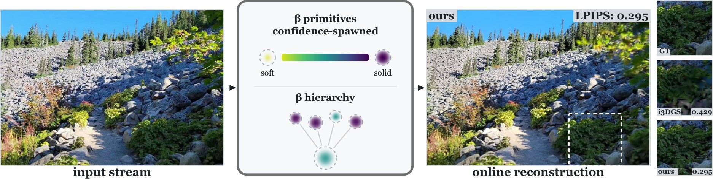

# Hierarchical Incremental Beta Splatting for Online Reconstruction



<p align="center">
  <a href="https://linus-franke.com">Linus Franke</a><br>
  University of Würzburg<br><br>
  <b>Accepted to WACV 2027</b><br><br>
  
  &emsp;&emsp;&emsp;
  
</p>

<p align="center">
  <a href="https://linus-franke.com/hibs"><b>Project Page</b></a> |
  <a href="https://arxiv.org/abs/2611.08288"><b>Paper</b></a>
</p>

Online radiance-field reconstruction from an unposed image stream. Beta kernels replace
Gaussians, and their shape carries confidence. New primitives start solid where multi-view
geometry verifies them and soft where it does not. A solidity controller turns accumulated
evidence into shape, error-driven relocation recycles dead primitives, and a closed-form
moment merge builds a shape-preserving level-of-detail hierarchy.


## Abstract

Online 3D Gaussian Splatting reconstructs a scene during capture: each keyframe spawns
primitives once and refines them for only a few dozen iterations, leaving little chance to fix
poor initialization or missing detail. Gaussians are also inherently soft, needing many
overlaps for solid surfaces.

We present Hierarchical Incremental Beta Splatting (HIBS), which brings beta kernels to
incremental reconstruction. Their shape parameter interpolates between a soft, Gaussian-like
profile and a flat-topped, near-opaque surfel, acting as a confidence dial for geometry. Our
confidence-aware spawning uses geometric observability and multi-view depth agreement to
initialize both opacity and shape, producing solid primitives where geometry is verifiable and
soft, correctable primitives where it is not. As online densification, error-driven
relocation recycles stale primitives into photometric-error hotspots. Bounded beta kernel
support enables exact tile culling and faster rasterization, and a closed-form,
shape-preserving merging formulation provides a level-of-detail (LOD) hierarchy for fast
optimization and real-time rendering. On Mip-NeRF 360 in the on-the-fly protocol, HIBS
improves PSNR by up to 0.8 dB while reducing optimization time by up to 40%.

## Citation

```bibtex
@inproceedings{franke2027hibs,
  title     = {Hierarchical Incremental Beta Splatting for Online Reconstruction},
  author    = {Franke, Linus},
  booktitle = {Proceedings of the IEEE/CVF Winter Conference on Applications of Computer Vision (WACV)},
  year      = {2027}
}
```

## Setup

Windows, Visual Studio 2022, CUDA 12.8:

```bash
git clone --recursive https://github.com/lfranke/hibs.git hibs && cd hibs
conda create -n hibs python=3.11 -y
conda activate hibs
pip install torch==2.11.0 torchvision --index-url https://download.pytorch.org/whl/cu128
pip install hatchling
pip install -r requirements.txt --no-build-isolation
pip install cupy-cuda12x==14.1.1     # ignore the "depth-anything-3 requires numpy<2" warning
scripts\build_extensions.bat %CONDA_PREFIX%\python.exe
```

Linux, GCC 10-14, CUDA 12.8:

```bash
git clone --recursive https://github.com/lfranke/hibs.git hibs && cd hibs
conda create -n hibs python=3.11 -y
conda activate hibs
pip install torch==2.11.0 torchvision --index-url https://download.pytorch.org/whl/cu128
pip install hatchling
pip install -r requirements.txt --no-build-isolation
pip install cupy-cuda12x==14.1.1     # ignore the "depth-anything-3 requires numpy<2" warning
bash scripts/build_extensions.sh python
```

Registration, matching and bundle adjustment come from
[i3DGS](https://github.com/graphdeco-inria/i3dgs). It is a submodule used as a library and is
not modified. [patches/](patches/) holds one optional i3DGS patch that removes per-match GPU
syncs (about 0.4% faster).

## Data

| datasets | download | `--root` |
|---|---|---|
| MipNeRF360 | [jonbarron.info/mipnerf360](https://jonbarron.info/mipnerf360/) | `mipnerf360=<path>` |
| On-the-fly benchmark: TUM, StaticHikes | [repo-sam.inria.fr/nerphys/on-the-fly-nvs/datasets](https://repo-sam.inria.fr/nerphys/on-the-fly-nvs/datasets/) | `i3dgs=<path>` |
| Tanks and Temples, Deep Blending | [tandt_db.zip](https://repo-sam.inria.fr/fungraph/3d-gaussian-splatting/datasets/input/tandt_db.zip) | `i3dgs=<path>`, in `tandt/` and `db/` |

`submodules/i3dgs/scripts/download_datasets.py --out_dir <path>` fetches all of these.
[scripts/scenes.json](scripts/scenes.json) gives the folder, image directory and test hold-out
for every scene.

## Run

```bash
python train.py -s <scene> -m <output>                    # reconstruct
python train.py -s <scene> -m <output> --test_hold 8      # hold out every 8th image and score it
python train.py -s <scene> -m <output> --large_scene      # scenes that exceed VRAM
```

The defaults are the configuration evaluated in the paper. Each component has its own flag
(for example `--no-relocate` or `--sb_lobes 0`). `python train.py -h` lists our options, and
`--help_i3dgs_args` lists the backbone options. `--num_iterations 50` (default 30) gains about
0.4 dB for about 20% more time (not used in the paper evaluation).

The output folder holds `hierarchy.ply` (standard 3DGS layout), `hierarchy_shape.npz` (the
beta shapes), `appearance.pt` (exposure), `metadata.json` (metrics, timings) and
`test_images/`. `--checkpoint_format embedded` stores the shapes inside the PLY instead.

## Viewer

| mode | command |
|---|---|
| live, during reconstruction | `python train.py -s <scene> --viewer_mode local` |
| saved reconstruction | `python viewer.py local <output>` |
| remote: server, then client | `python train.py -s <scene> --viewer_mode server` or `python viewer.py server <output>`, then `python viewer.py client --ip <host>` |

- `W A S D Q E` move the camera and `I K J L U O` rotate it.
- The **Beta Field** render mode colours each primitive by its shape (viridis, solid to
  soft), which shows the confidence field.
- During training, `Throttling` and `Max FPS` share the GPU between the viewer and the
  optimization. Use `--keep_alive` to keep the viewer open after the reconstruction finishes.
- The default port is `6009` (`--port`).
- On the first start, the settings window can be hidden behind the `Point View` window.

## Paper tables

```bash
python scripts/paper_tables/tables_paper.py --tables 1 --root mipnerf360=<path> --root i3dgs=<path>
python scripts/paper_tables/tables_supplement.py --tables 4,5
python scripts/paper_tables/tables_paper.py --report          # re-collect existing runs
python scripts/paper_tables/tables_paper.py --latex           # print the LaTeX rows from the csvs
```

| paper | | supplement | |
|---|---|---|---|
| 1 | TUM, MipNeRF360 (otf), StaticHikes | 4 | low-resolution protocol |
| 2 | MipNeRF360, Tanks and Temples, Deep Blending | 5 | 448x448 input |
| 3 | SmallCity, CityWalk | 6, 7 | SB lobes against SH |
| 4 | component and large-scene ablation | 8, 9 | TUM pose accuracy, bootstrap |
| 5 | kernel ablation | 10-12 | relocation, solidity step, sensitivity |
| | | 14, 15 | full 3DGS benchmark, unordered input |

Runs go to `results/<table>/`. Each table averages `--repeats` runs per scene and writes
`runs.csv`, `scenes.csv` and `table.csv`. Ablation rows marked "full" reuse the runs of tables
1-3, so run those first. `--help` lists every table with its directory. Rows for other methods
come from their own repositories.

## LLM Usage Statement

We used Claude Fable 5.0 and 5.1, Claude Opus 5 and 5.5 (Anthropic), as well as GPT-5.6 Luna
(OpenAI) to help draft and edit text and figures, generate and debug code, and develop and
check the mathematical formulation of the hierarchical merge. All outputs were reviewed and
verified for accuracy and relevance.
